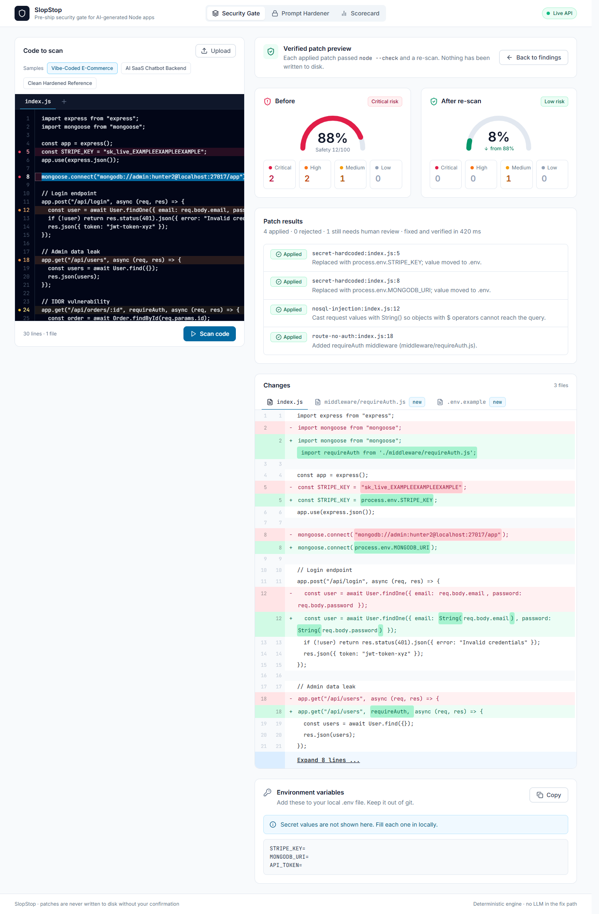

# SlopStop

**A pre-ship security gate and verified auto-patcher for AI-generated ("vibe-coded") Node.js / Express / MongoDB apps.**

Track 03 · R1 *Vibe-coded and vulnerable* · Team Skuld

AI coding tools ship working apps in minutes, and the same flaws keep showing up: hard-coded keys, routes with no login check, raw request bodies passed into database queries, and outdated packages. Asking another LLM to "fix it" often swaps those bugs for broken syntax or deleted features.

SlopStop **scans**, **fixes** and **verifies** before anything ships. **Rules mode** is fully deterministic. **Hybrid mode** adds an LLM to find and fix what the rules miss: **QwenSkuld**, our fine-tuned Qwen2.5-Coder-1.5B running offline through Ollama, or Gemini. Every AI fix must pass six checks the model does not control, including a real HTTP attack test, and anything that fails is rejected. **AI proposes, deterministic code proves.** SlopStop never writes to your files without your confirmation.


## Results

Measured by `node corpus/benchmark/run.js` on our 30-app corpus (25 apps with 56 planted flaws, 5 clean apps). The full method and caveats are in [docs/README.md](docs/README.md#6-official-benchmark-scorecard-from-resultsjson).

| | Target (problem statement) | SlopStop |
|---|---|---|
| Fewer critical + high findings | over 75% | **86%** (65 → 9) |
| Time per app (scan + fix + verify + re-scan) | under 1.5 s | **about 0.14 s** |
| Planted flaws found | | **56 / 56** |
| False alarms on clean apps | | **0** |
| Planted flaws auto-fixed | | **37 / 56** (all 14 secrets, all 12 auth, 11/12 injection) |
| Patches rejected by the verifier | | **0** |

The other 19 planted flaws (11 IDOR, 7 vulnerable dependencies, 1 string-built query) are **reported for human review by design**: fixing them needs business logic SlopStop will not guess.

**Compared with an existing scanner on the same apps** (`node corpus/baselines/run-all.js`):

| Tool | Planted flaws found | Fixes | Alarms on clean apps |
|---|---|---|---|
| **SlopStop** | **56 / 56** | 37 planted flaws auto-fixed | 0 |
| Semgrep 1.186 (JS, Express, NodeJsScan and secrets rulesets) | 12 / 56 | none (detection only) | 1 |

**Caveat:** the team wrote the corpus from the same list of flaw types the scanner targets, so expect lower numbers on real-world code. The outside test below confirms this.

## AI + verifier: the experiment

**Hypothesis:** an LLM finds and fixes flaws that rules miss, but only a deterministic verifier makes its output safe to ship.

**Experiment:** three arms run on the same 51 apps.

| Arm | What it does |
|---|---|
| **Rules** | The deterministic engine |
| **AI only** | Gemini detects flaws, then rewrites each file, with no verification |
| **Hybrid** | Rules plus Gemini; every AI patch must pass six checks |

The six checks are: `node --check`, a rule re-scan, real names only, an independent AI re-check, **HTTP attack mode** (the exploit must be blocked) and **HTTP normal mode** (the real user must still get through).

Gemini 3.1 Flash-Lite, 2 runs per AI arm. Method, numbers and failure analysis: [corpus/experiment/README.md](corpus/experiment/README.md).

| | Rules | AI only | **Hybrid** |
|---|---|---|---|
| Corpus (30 apps): planted flaws found | 56/56 | 37/56 | **56/56** |
| Corpus: critical/high removed | 86% | 55% | **99%** |
| **DVNA** (outside app we did not write): documented flaws found | **1/6** | **4/6** | 3/6 |
| DVNA: critical/high removed | 46% | 27% | **62%** |
| Apps broken (syntax or deleted routes) | 0 | 0 | 0 |

- **The rules are tuned to our corpus.** On outside code they find 1 of 6; the AI finds 4 of 6.
- **The AI alone fixes far less, unverified.** Hybrid removes 99% of critical/high findings.
- **The verifier catches the AI's mistakes.** On Gemini-written apps it rejected 13 of 16 AI patches. In live testing it caught an ownership check that compiled and passed the re-scan but locked users out of their own records. Only the HTTP normal-mode test caught it.
- **Prompt Hardener:** Gemini code from hardened prompts had **63% fewer** critical/high findings than from raw prompts (15 vs 41).
- **Negative result (Gemini):** "the LLM alone breaks apps" was not shown. The AI-only arm broke 0 apps by our syntax and route checks; its weakness is fixing much less.
- **With our local QwenSkuld** (1 run on the training laptop, not in the committed results): the AI-only arm broke 8 of 51 apps (35 routes deleted). In Hybrid the verifier rejected 61% of its patches and 0 apps broke.

**Fine-tuning an open model: QwenSkuld** ([training/README.md](training/README.md)). We started with the Gemini API, but a hosted model can only be prompted, not fine-tuned, and every call sends code off the machine. So we fine-tuned **Qwen2.5-Coder-1.5B** with LoRA on vulnerable/secure JavaScript pairs from CyberNative/Code_Vulnerability_Security_DPO and SecureCodePairs (comments stripped, so the model reads code, not hints). Training took **5.4 minutes on a laptop RTX 4060** and the model runs locally via Ollama as **QwenSkuld** (`slopstop-qwen` in the training scripts).

**Model comparison** (`node server/eval/models.js`): each model sees the same task it was trained on (snippet → vulnerable? + category). There are 122 labelled snippets (61 vulnerable) from the 30 corpus apps and DVNA, and none of these apps were in the training data.

Both Qwen rows are like-for-like: 8-bit, the same code-only input as in training, and the same output-length cap. Invalid answers are never dropped. One on a vulnerable snippet counts as a miss, and every invalid answer counts as wrong in accuracy.

| Model | Accuracy | Precision | Recall | F1 | Category correct | Invalid answers | Time per snippet |
|---|---|---|---|---|---|---|---|
| Rules | **95%** | 0.94 | **0.97** | **0.95** | 0.81 | 0 | instant |
| Gemini 3.1 Flash-Lite (hosted) | 86% | 0.92 | 0.79 | 0.85 | **0.88** | 0 | 4.9 s |
| Qwen2.5-Coder-1.5B, base (local) | 44% | 0.55 | 0.59 | 0.57 | 0.28 | 36 of 122 | 2.6 s |
| **QwenSkuld** (Qwen2.5-Coder-1.5B fine-tuned, local) | **66%** | 0.72 | 0.54 | **0.62** | **0.70** | **0** | 0.6 s |

- **Fine-tuning made the small model usable** on apps it never saw:
  - accuracy rose from 44% to 66%
  - correct categories rose from 28% to 70%
  - invalid answers fell from 36 to 0
  - it answers about 4× faster than the base model
- **The gain is smaller than on the training validation set** (85% there vs 66% here). The corpus apps are different code from the training data, and recall is still low (0.54).
- **Recall fell from 0.74 to 0.54** once the `File: <path>` line was removed from the prompt so the input matched the training format exactly. The file name was apparently giving the model useful context. The training data was also skewed: 260 injection, 37 IDOR, 6 auth, 3 secret and 0 dependency examples.
- **Gemini is still clearly better (86%), and rules lead on this corpus** (95%), because they were built from its flaw list. That is why the product is rules first, AI for what rules cannot express, and every AI fix verified.
- **Measurement note:** an earlier version of this table showed base F1 0.09 vs fine-tuned 0.75. That comparison was not like-for-like (a 4-bit base, and an extra file-name header in the input), and the scorer dropped invalid answers. Role A caught both; the numbers above are the corrected ones.

## What it checks

| Flaw | Example | Auto-fix |
|---|---|---|
| Hard-coded secrets | `const KEY = "sk_live_..."`, passwords in DB URIs | ✅ moved to `.env` as `process.env.*` |
| NoSQL / SQL injection | `User.find(req.body)`, template-string SQL | ✅ simple cases (field values cast, simple SQL parameterised); whole-filter, `$where` and `LIKE` patterns are reported for review |
| Unauthenticated routes | `app.get("/api/users", ...)` or `router.get(...)` with no auth middleware | ✅ `requireAuth` added |
| Vulnerable dependencies | `jsonwebtoken@8.5.1` | Reported, upgrade suggested |
| IDOR / BOLA | `Order.findById(req.params.id)` with no ownership check | Reported for human review |

**Scope:** JavaScript/TypeScript Express backends. Other languages and frameworks, plus flaw types such as XSS and CSRF, are out of scope.

## Quick start

Requires Node.js 20+ and npm 10+.

```bash
npm install                 # from the repo root (npm workspaces)
npm start -w server         # API on http://127.0.0.1:3001
npm run dev -w web          # dashboard on http://localhost:5173 (second terminal)
```

Open the dashboard, pick a sample app, click **Scan code**, then **Fix automatically**. Without the API, set `VITE_USE_MOCK=true` in `web/.env` (see `web/.env.example`) to run on built-in sample data.

**Hybrid mode with QwenSkuld (offline).** Build the model as in [training/README.md](training/README.md#ollama) (`ollama create QwenSkuld -f training/Modelfile`), then start the API with:

```bash
AI_PROVIDER=ollama OLLAMA_MODEL=QwenSkuld npm start -w server   # OLLAMA_URL defaults to http://localhost:11434
```

For Gemini instead, set `GEMINI_API_KEY`. `GET /api/health` shows which model is active. Example apps to try (two that pass, one that fails, and the demo apps) are in [examples/](examples/README.md).

## The dashboard: a three-stage security gate

In Hybrid mode the **Security Gate** tab runs the code through three animated stages, with a live activity log:

1. **Static rules.** The deterministic engine; secrets are masked (`maskSecrets`) before any model sees the code.
2. **QwenSkuld.** The fine-tuned model looks for what the rules cannot express (for example IDOR). Its findings are always "review".
3. **Live HTTP test.** **Auto-fix & HTTP verify** patches the app, runs it in a sandbox and attacks it: each exploit must go from 200 to 401 while a logged-in user still gets 200.

The ship gate then shows **Blocked**, **Needs review** or **Ready to ship**. The **Scorecard** tab mirrors the same three stages and adds a **Why QwenSkuld** chart (accuracy of rules, Gemini, base Qwen and QwenSkuld on 122 unseen snippets, with where it is *not* better).

## The four stages

1. **Scan.** Deterministic AST (acorn) and pattern rules find the flaws above, each with a line number and a fix preview.
2. **Fix.** Template rewrites: secrets go to `.env` (values are never written anywhere), auth middleware is added and query inputs are cast. IDOR and dependencies are reported, never guessed.
3. **Verify.** Every patched file must pass `node --check` and a re-scan. A patch is rejected if it breaks syntax, leaves its target flaw, or introduces a new critical/high finding.
4. **Prove it.** The exploit demo sends the same unauthenticated request to an unprotected route (HTTP 200, data leaked) and the patched route (HTTP 401). The scorecard shows the benchmark.



## Other ways to run it

**Pre-commit hook** blocks commits that contain critical/high findings:
```bash
npx slopstop-init                       # install the hook
npx slopstop scan --staged --fix        # see verified fix proposals (never written to disk)
npx slopstop scan src/ --json           # scan files or folders
npx slopstop compare dirA/ dirB/        # compare two sets of apps
```

**GitHub Action** fails a PR on critical/high findings in changed files and posts verified fixes to the job summary:
```yaml
- uses: actions/checkout@v4
  with: { fetch-depth: 0 }
- uses: AlgoWanderer/tech-habba@main
```
This repo gates its own pull requests with it ([`.github/workflows/ci.yml`](.github/workflows/ci.yml)). Intentional cases can be suppressed with `.slopstopignore` or `// slopstop-ignore <ruleId>: reason`, and suppressed findings are still listed.

**Prompt Hardener** (`POST /api/harden-prompt`; removed from the dashboard to keep the demo on the gate) strips API keys, tokens and DB passwords from a prompt before it reaches an AI model, and prepends 7 security rules for the generated code.

## Repository layout

| Folder | What |
|---|---|
| `core/` | Scanner, fixers and prompt hardener (deterministic, no LLM) |
| `server/` | Express API, verifier (`node --check` + re-scan) and exploit sandbox |
| `cli/` | `slopstop` CLI and pre-commit hook installer |
| `web/` | React + Vite + Tailwind dashboard (three-stage gate, scorecard) |
| `training/` | Fine-tuning scripts for QwenSkuld (data and weights are git-ignored) |
| `examples/` | Deliberately vulnerable apps for trying the gate |
| `corpus/` | 30 test apps, ground truth, benchmark and baselines |
| `contract/` | Frozen API/data contract and samples |
| `docs/` | Detailed docs, demo script, limitations |

## Tests

```bash
npm test --workspaces --if-present      # core, server and cli test suites
node corpus/benchmark/run.js            # regenerate the benchmark numbers
```

## Limitations

- **IDOR/BOLA** and other business-logic flaws are never auto-fixed by rules. In Hybrid mode the AI may fix them, and the fix is applied only if the HTTP test proves strangers are refused and the owner still gets their data.
- **The rules miss what they were not built for:** on DVNA they missed command injection, a low-entropy session secret, a missing admin-role check, IDOR via `req.body.id` and `mathjs`.
- **Node 25+:** the HTTP-test sandbox uses Node's permission model, so it now also passes `--allow-net` when the runtime supports it (the app under test still only reads its own sandbox folder). Without that flag the test silently never ran on newer Node versions.
- **The HTTP test** covers missing auth, IDOR and NoSQL injection in apps the sandbox can run (mongoose and JWT stubs). Anything else is reported as not testable. It runs the submitted code locally, so the API must stay local-only.
- **AI output varies between runs**, so the experiment reports means and ranges. QwenSkuld can also raise false positives (see `examples/pass-2-notes-app.js`) and its fixes for IDOR are sometimes rejected; only HTTP-proven fixes carry an attack proof.
- **Not detected by either layer:** path traversal and command injection via `exec()` (QwenSkuld sometimes flags `exec`, but cannot yet produce an accepted fix). See `examples/fail-converter-app.js`.
- **Custom auth middleware** is recognised by name patterns (e.g. `requireAuth`, `protect`, `verifyJwt`, `checkToken`) or by an inline 401/403 check in the handler. A route protected by a check with an unusual name can be reported as unauthenticated. Review the proposed patch before applying it.
- **Dependency checks** use a built-in advisory list, not the live npm advisory database.
- **The corpus** shares its flaw list with the scanner (see the caveat above), which is why we also test on DVNA and on 20 Gemini-written apps.
