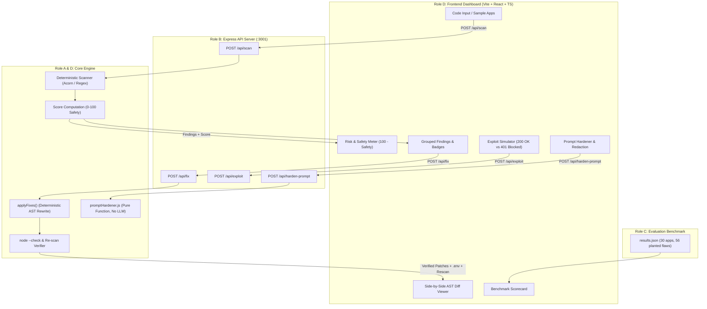

# SlopStop 🛡️
> **Pre-ship security gate and verified auto-patcher for AI-generated ("vibe-coded") Node/Express/MongoDB applications.**

SlopStop acts as an automated, deterministic security firewall between AI code generation and deployment. It prevents vulnerable AI "slop" from reaching production by scanning, safely auto-patching with verified AST rewrites, and proving exploit mitigation—with zero hallucination and zero regressions.

---

## 1. What SlopStop Is

Modern vibe-coded applications built with LLMs frequently leak credentials, expose unauthenticated routes, and pass raw query objects directly into database queries.

SlopStop provides a deterministic safety gate:
* **AST/Regex Analysis**: Deterministic scanning of Node.js/Express/MongoDB syntax trees. No LLM in the fix path.
* **Verified Auto-Patching**: Transforms vulnerable code into hardened code using syntax-safe AST rewrites.
* **Verification Invariant**: Every patch is executed through `node --check` and re-scanned. Any patch that introduces syntax errors or fails to eliminate the vulnerability is discarded.
* **Safe In-Memory Staging**: Patches are **never** auto-applied to the user's disk without explicit confirmation.
* **Credential Hygiene**: Automatically generates sanitized `.env` templates without leaking secrets into git.
* **Prompt Hardener**: Client-side/local redaction of sensitive credentials prior to prompt submission to LLMs, wrapped with mandatory architectural security constraints.

---

## 2. Architecture Diagram



---

## 3. How to Run

### Prerequisites
* **Node.js**: v20+ (Tested on v24.15.0)
* **npm**: v10+ (Workspaces enabled)
* **OS**: Windows (PowerShell / Git Bash) or Linux / macOS

### Installation
From the repository root:
```bash
npm install
npm install --prefix web
```

### Running Tests
To verify the Prompt Hardener test suite:
```bash
npm test
# or
npx vitest run
```

### Starting the Web Dashboard
```bash
npm run dev --prefix web
```
The dashboard starts on `http://localhost:5173`.

### Environment Configuration
Located in `web/.env`:
```ini
# Toggle between mock mode and real server
VITE_USE_MOCK=true
VITE_API_URL=http://localhost:3001
```
* `VITE_USE_MOCK=true`: Fully runs standalone in browser using frozen contract samples (`contract/sample-scan.json`, `contract/sample-fix.json`).
* `VITE_USE_MOCK=false`: Connects directly to the live backend server on port 3001.

---

## 4. 3-Minute Demo Script (Screen Order & Pitch Flow)

| Time | Screen | Action & Talk Track |
|---|---|---|
| **0:00 - 0:40** | **Security Gate (Left Input)** | *“Vibe-coding with LLMs generates working code in minutes, but produces severe security vulnerabilities. Here is a typical vibe-coded Express/MongoDB app with hardcoded Stripe secrets, MongoDB passwords, and NoSQL injection sinks.”* <br>Click **Scan Code**. |
| **0:40 - 1:15** | **Security Gate (Scan View)** | *“Notice the Safety Score is 12/100 (88% Critical Risk). The semicircular gauge immediately highlights 2 Critical secrets, 2 High injection/auth risks, and 1 Medium IDOR flaw. Each finding has line numbers and deterministic fix previews.”* |
| **1:15 - 1:50** | **Exploit Simulator** | *“Before patching, let’s simulate an exploit. We hit ‘Run Exploit Simulation’. Left: The unauthenticated `/api/users` endpoint returns sensitive records with a 200 OK. Right: Post-mitigation returns 401 Unauthorized, dropping the attack.”* |
| **1:50 - 2:25** | **Fix View (Diff Viewer)** | *“Click ‘Fix All Auto-Fixable’. SlopStop rewrites the AST deterministically, runs `node --check`, and re-scans. The diff viewer shows the side-by-side patch. Notice the generated `.env` template—values are never exposed. The risk meter drops from 88% down to 8%.”* |
| **2:25 - 2:45** | **Prompt Hardener** | *“Switch to the Prompt Hardener tab. Developers paste raw prompts containing API keys and passwords. SlopStop strips secrets locally, replaces them with `<API_KEY_1>`, and injects 7 mandatory security constraints before the prompt ever touches an external LLM.”* |
| **2:45 - 3:00** | **Benchmark Scorecard** | *“Switch to Scorecard. On our 30-app test corpus: all 56 planted flaws found, zero false alarms on clean apps, and critical/high findings cut from 65 to 9 (86%) in about 130 ms per app. Every applied fix passed the syntax check and re-scan.”* |

---

## 5. Honest Limitations & Failure Analysis

SlopStop takes a principled, non-handwaving stance on security automation:

1. **IDOR / BOLA Logic Flaws (Human Review Required)**:
   * **Limitation**: In resource lookups like `app.get("/api/orders/:id")`, verifying whether the requesting user owns the order requires domain-specific authorization logic (e.g., checking `order.userId === req.user.id` or multi-tenant organizational scope).
   * **Action**: SlopStop deterministically detects IDOR candidates and flags them as `review`. It never guesses business logic.

2. **Patch Rejection (0 of 56 fixes rejected on our corpus)**:
   * Any generated patch that fails `node --check` syntax validation or leaves secondary findings is discarded immediately with status `"rejected"`. We prioritize never breaking running code.

3. **Complex AST Evaluators**:
   * Dynamic property accesses or multi-nested functional closures that cannot be statically proven safe are reported for manual developer intervention rather than guessed.

---

## 6. Official Benchmark Scorecard (from results.json)

Generated by `node corpus/benchmark/run.js` (real core + server pipeline). Re-run it after any engine change.

* **Benchmark Corpus**: 30 vibe-coded Node/Express/MongoDB apps written by the team (25 with planted flaws, 5 clean)
* **Planted flaws found (recall)**: 56 / 56, across secrets, injection, auth, IDOR and dependencies
* **False alarms on clean apps**: 0
* **Critical + high findings**: 65 before, 9 after fixing (**86.2% fewer**); the 9 left are flagged for human review
* **Fixes**: 56 applied, 0 rejected by the verifier, 20 left for human review (IDOR, vulnerable dependencies, string-built `$where` queries)
* **Time**: about 130 ms per app (scan + fix + verify + rescan), p95 about 240 ms
* **Precision vs ground truth**: 74%. The unmatched findings we checked are mostly real flaws the corpus did not label.
* **Caveat**: the corpus and the scanner were built from the same list of flaw types, so real-world results will be lower.
* **Semgrep 1.186** (`p/javascript`, `p/expressjs`, `p/nodejsscan`, `p/secrets`, real run): 12 / 56 planted flaws (8/14 secrets, 4/12 injection, 0 auth, 0 IDOR, 0 dependency), 1 finding on clean apps, detection only (no fixes). Matching is generous to it: same file, line ±1, any category.
* **Gitleaks 8.30** (real run): 0 / 56. Not a fair secrets comparison: the corpus keys are deliberately fake-format strings that real-key patterns do not match.
* **LLM-only fixer**: not yet measured. Save real model outputs to `corpus/baselines/llm-output/` (see the README there) and re-run `node corpus/baselines/run-all.js`.
